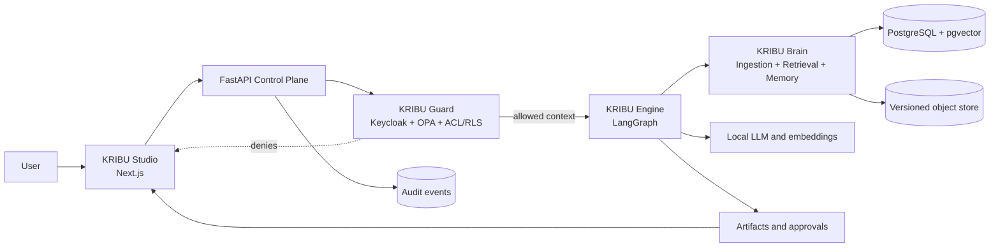
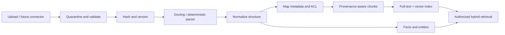
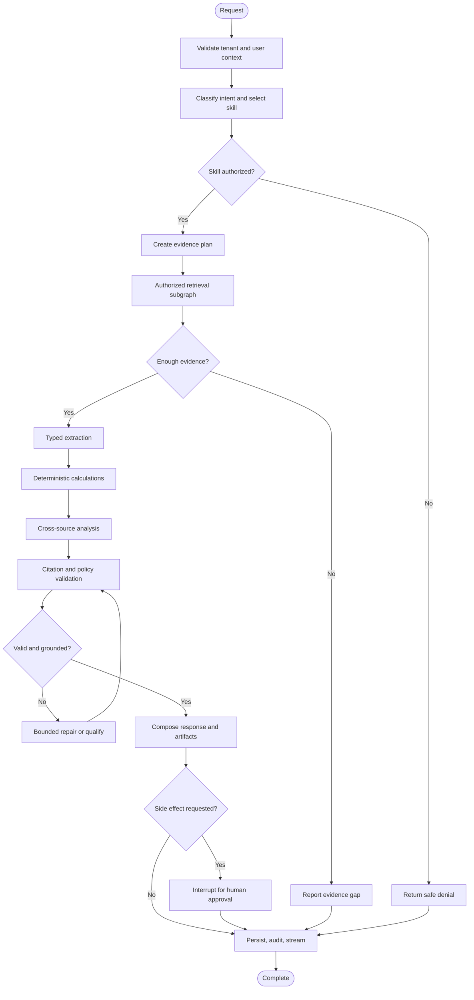

# KRIBU Demo Architecture

**Status:** Proposed implementation architecture

**Primary orchestration:** LangGraph

**Deployment for demo:** Local Docker Compose and locally hosted models

## 1. Architecture principles

1. Authorization precedes retrieval; inaccessible content never reaches a model.
2. Deterministic code handles policy, arithmetic, validation, and side effects.
3. Models interpret and synthesize evidence but do not become a source of truth.
4. Every business fact retains immutable source-version provenance.
5. Domain stories are versioned skills over common platform components.
6. Interfaces isolate replaceable infrastructure and client-specific schemas.
7. Begin as a modular monolith plus workers; split services only when measured needs justify it.

## 2. High-level flow



### Query-to-response sequence

1. Studio submits a query with the user's OIDC access token.
2. FastAPI validates issuer, audience, signature, expiry, tenant, and session.
3. Guard resolves trusted user attributes and asks OPA whether the action is allowed.
4. Engine creates a run and LangGraph checkpoint, then selects an authorized skill.
5. Retrieval builds mandatory SQL filters from tenant and ACL grants before search.
6. Brain performs full-text and vector searches only within that authorized candidate set.
7. Engine extracts typed facts, runs deterministic calculations, and compares evidence.
8. Citation validation removes or qualifies claims without sufficient support.
9. Guard applies output policy and verifies every cited source is still accessible.
10. Studio streams findings, limitations, and evidence links; artifacts are saved as drafts.
11. Any external action becomes an approval request and cannot execute in the demo.
12. The audit log receives the complete decision trail without storing secrets.

## 3. Component boundaries

| Component | Owns | Must not own |
|---|---|---|
| KRIBU Studio | User interaction, progress display, evidence navigation, approval UI | Authorization decisions or direct database access |
| API control plane | Request validation, use-case services, transactions, stable API contracts | Model reasoning in route handlers |
| KRIBU Guard | Authentication context, RBAC/ABAC, ACL projection, policy decisions, approval rules | Semantic retrieval or probabilistic permission grants |
| KRIBU Brain | Ingestion, normalized content, provenance, indexing, authorized retrieval, facts/entities | Deciding user access without Guard inputs |
| KRIBU Engine | LangGraph state, skill execution, tools, analysis, citations, interrupts | Bypassing services with arbitrary SQL or executing unapproved actions |
| Skill packs | Domain schemas, prompts, extraction and report rules, golden examples | Infrastructure, identity, or generic retrieval implementations |
| Connector adapters | Future discovery/fetch/ACL mapping/action APIs | Credentials in code or action without approval token |
| Audit/evaluation | Append-only events, run traces, golden-dataset results | Editing business records |

## 4. KRIBU Guard

### Decision model

OPA receives a normalized, non-LLM input:

```json
{
  "subject": {"tenant_id": "t1", "user_id": "mike", "roles": ["engineer"], "department": "engineering"},
  "action": "document.read",
  "resource": {"tenant_id": "t1", "type": "employee_record", "classification": "restricted_hr", "owner_id": "roger"},
  "environment": {"purpose": "general_query", "skill": "hr_history"}
}
```

Policy returns allow/deny, reason codes, obligations, and the policy version. SQL row-level security and application filters enforce the same tenant boundary as defense in depth.

For a query such as "What is Mr Albert's salary?", Mike's role and department do not satisfy the `restricted_hr` policy. The request is denied before chunks are searched. Vector similarity is never used as authorization. An optional lightweight local classifier may detect sensitive intent and force denial or review, but cannot override a deterministic denial or create permission.

### Generic-industry adaptation

- Canonical attributes: tenant, subject, action, resource type, classification, owner, department, project, jurisdiction, purpose, and time.
- Client adapters map source-specific roles, groups, labels, and ACLs into this canonical model.
- Policy bundles are versioned per tenant and domain, not hard-coded around employee names or one database schema.
- Missing mappings deny access and enter an administrative review queue.

## 5. KRIBU Brain

### Ingestion pipeline



Original files are immutable. A `DocumentVersion` owns normalized blocks; each `Chunk` points to a page/section/table/sheet/row/cell locator. Embeddings are derived and replaceable. Facts never replace citations to their original source.

### Retrieval

1. Compile tenant and ACL constraints into SQL.
2. Retrieve lexical and semantic candidates inside the allowed set.
3. Merge ranks using reciprocal-rank fusion.
4. Optionally rerank locally after authorization.
5. Enforce diversity and evidence coverage.
6. Return `EvidenceRef` objects, not untracked strings.

## 6. KRIBU Engine



### State and tools

- `RunState`: request, tenant context, selected skill/version, evidence plan, evidence refs, extracted facts, findings, artifacts, approval state, errors, and retry counters.
- Nodes receive narrow typed inputs and return explicit state updates.
- Tools call application services; nodes do not issue arbitrary SQL or filesystem operations.
- PostgreSQL checkpoints make interrupts, retries, and process restarts durable.
- Repair loops have hard attempt limits and route to a qualified answer rather than looping indefinitely.

## 7. Technology stack

All demo services are self-hosted and usable without a paid account.

| Area | Selection | Notes |
|---|---|---|
| Web | Next.js, React, TypeScript, Tailwind CSS, shadcn/ui, TanStack Query | Self-hosted; REST and SSE client |
| API | Python, FastAPI, Pydantic, SQLAlchemy, Alembic | Modular monolith with typed contracts |
| Workflow | LangGraph OSS | Durable graphs, checkpoints, streaming, interrupts |
| Local inference | Ollama behind `ModelProvider` | Default model chosen by local hardware benchmark |
| Embeddings/reranking | Sentence Transformers with BGE-family open models | Local, configurable, multilingual-capable |
| Parsing | Docling; openpyxl for exact spreadsheet provenance | RapidOCR/Tesseract when OCR is required |
| Database/search | PostgreSQL + pgvector | Relational data, full-text search, vectors, RLS |
| Object storage | Local filesystem adapter for demo | S3-compatible adapter added when deployment requires it |
| Identity | Keycloak | Self-hosted OIDC, demo users/groups/roles |
| Policy | Open Policy Agent (OPA) | Versioned RBAC/ABAC policy-as-code |
| Jobs | Celery + RabbitMQ | Ingestion and independent background work; not LangGraph state |
| Observability | Structured logs + OpenTelemetry | Langfuse FOSS is an optional local Compose profile |
| Testing | pytest, Vitest only where useful, Playwright smoke tests | Security, retrieval, citations, graphs, and three journeys |
| Tooling | uv, pnpm, Ruff, mypy, ESLint, Prettier | Versions pinned after the scaffold spike |
| Runtime | Docker Compose | No hosted runtime required for the demo |

References: [LangGraph persistence](https://docs.langchain.com/oss/python/langgraph/persistence), [OPA](https://www.openpolicyagent.org/docs), [Docling formats](https://docling-project.github.io/docling/usage/supported_formats/), [pgvector](https://github.com/pgvector/pgvector), [Keycloak](https://www.keycloak.org/), and [Next.js self-hosting](https://nextjs.org/docs/app/guides/self-hosting).

## 8. Monorepo structure

```text
Kribu-Demo/
|-- apps/
|   `-- web/                         # Next.js Studio and admin UI
|-- services/
|   |-- api/
|   |   |-- app/
|   |   |   |-- api/                # HTTP/SSE routes and dependencies
|   |   |   |-- core/               # config, errors, logging, transactions
|   |   |   |-- identity/           # OIDC context and tenant resolution
|   |   |   |-- policy/             # OPA client and authorization service
|   |   |   |-- documents/          # metadata, versions, upload lifecycle
|   |   |   |-- brain/              # provenance, facts, entities, retrieval
|   |   |   |-- engine/             # graph, state, nodes, tools, checkpoints
|   |   |   |-- skills/             # registry and three domain skill packs
|   |   |   |-- approvals/          # interrupts and decisions
|   |   |   |-- artifacts/          # generated outputs and downloads
|   |   |   `-- audit/              # append-only application events
|   |   |-- migrations/
|   |   `-- tests/                   # focused unit/integration/security tests
|   `-- worker/                      # ingestion and indexing Celery tasks
|-- packages/
|   |-- ui/                          # shared React primitives and tokens
|   `-- api-client/                  # generated TypeScript API client
|-- policies/
|   |-- rego/                        # OPA policy modules
|   `-- tests/                       # policy decision tables
|-- data/
|   `-- demo/
|       |-- ngo-project/
|       |-- hr/
|       |-- complaints/
|       `-- golden/                  # expected facts and answers
|-- infra/
|   |-- compose/
|   |-- keycloak/                    # exported demo realm
|   `-- observability/
|-- scripts/                         # repeatable bootstrap/seed commands
|-- Docs/                            # source requirements and diagrams
|-- PRD.md
|-- Architecture.md
|-- rules.md
|-- phases.md
|-- design.md
`-- memory.md
```

## 9. Core data contracts

- `Tenant`, `UserProfile`, `RoleAssignment`, `PolicyBundle`
- `Source`, `Document`, `DocumentVersion`, `NormalizedBlock`, `Chunk`
- `ACLDescriptor`, `AuthorizationDecision`
- `Entity`, `Fact`, `Relationship`, each with evidence references
- `EvidenceRef(document_version_id, locator, excerpt_hash, score)`
- `SkillDefinition(version, schemas, permissions, side_effect_level)`
- `Run`, `RunCheckpoint`, `Finding`, `Artifact`
- `ApprovalRequest`, `ApprovalDecision`, `ConnectorAction`
- `AuditEvent(actor, action, resource, decision, correlation_id, timestamp)`

Every tenant-owned table carries `tenant_id`. Source-derived rows carry `document_version_id`; deleting an active source marks it unavailable and triggers index cleanup rather than silently erasing audit history.

## 10. API surface

- `POST /v1/documents/uploads`, `GET /v1/documents/{id}`
- `POST /v1/runs`, `GET /v1/runs/{id}`, `GET /v1/runs/{id}/events` (SSE)
- `GET /v1/runs/{id}/findings`, `GET /v1/evidence/{id}`
- `GET /v1/artifacts/{id}`
- `GET /v1/approvals`, `POST /v1/approvals/{id}/decision`
- `GET /v1/skills`, administration endpoints for demo metadata/policies
- `GET /v1/audit-events`

Errors use a stable problem-details envelope with a safe message, machine code, correlation ID, and retryability. Internal prompts, stack traces, secrets, and inaccessible resource details are never returned.

## 11. Evolution after demo approval

- Add client-specific source adapters through the `Connector` interface after discovery.
- Replace local filesystem storage with an object-store adapter when deployment needs it.
- Benchmark hosted and local model providers without changing graph or skill contracts.
- Add approval-backed external actions using narrow OAuth scopes and idempotency keys.
- Add dedicated tenant deployment, HA, backups, and infrastructure-as-code only for the chosen environment.
- Introduce a separate graph database only if measured relationship queries exceed PostgreSQL's practical boundary.
